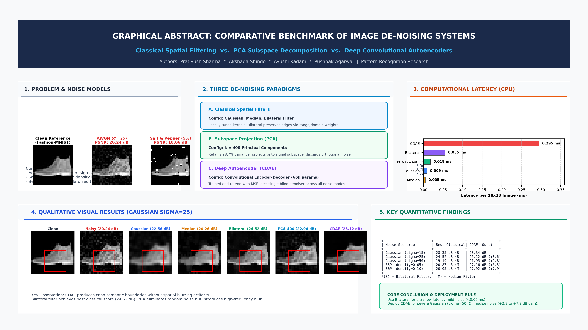

# Image De-noising System: Classical Filtering vs. Subspace Learning vs. Deep Convolutional Autoencoders

[](https://www.python.org/downloads/)
[](https://pytorch.org/)
[](https://opensource.org/licenses/MIT)
[](./IEEE_Image_Denoising_Paper.pdf)

An empirical pattern recognition study evaluating three fundamental image restoration paradigms: **Classical Spatial Filtering** (Gaussian, Median, Bilateral), **Linear Subspace Projection** (Principal Component Analysis - PCA), and **Deep Representation Learning** (Convolutional Denoising Autoencoder - CDAE).

---

## 👥 Authors & Collaborative Contributions
* **Pratiyush Sharma** ([@sharmapratiyush02](https://github.com/sharmapratiyush02)) - *Lead Researcher, Pipeline Architecture & Execution Engine*
* **Akshada Shinde** ([@Akshada2709](https://github.com/Akshada2709)) - *Classical Filtering Optimization & Quantitative Benchmark Metrics*
* **Ayushi Kadam** ([@ayuushi18](https://github.com/ayuushi18)) - *Deep Learning Model Architecture & Visual Evaluations*
* **Pushpak Agarwal** ([@PushpakAg10](https://github.com/PushpakAg10)) - *IEEE Research Paper, Interactive Notebook & Graphical Abstract*

*Department of Computer Science and Engineering — Pattern Recognition & Machine Intelligence Research Group*

---

## 📊 Graphical Abstract


---

## 🔬 Project Overview & Motivation
Digital image acquisition in low-light photography, clinical imaging (low-dose CT/MRI), and remote transmission inevitably suffers from stochastic sensor noise:
1. **Additive White Gaussian Noise (AWGN):** Models thermal agitation and electronic sensor readout fluctuations ($\sigma \in \{15, 25, 50\}$).
2. **Impulse Salt-and-Pepper (S&P) Noise:** Models analog-to-digital bit transmission errors ($d \in \{0.05, 0.10\}$).

This study rigorously assesses whether modern non-linear convolutional networks retain clear advantages over carefully tuned classical baselines and subspace projections under varying noise regimes.

### The Three Evaluated Paradigms
1. **Classical Spatial Filtering:**
   * *Gaussian Filter:* Linear distance-weighted kernel smoothing ($k \in \{3,5\}, \sigma \in [0.5, 1.5]$).
   * *Median Filter:* Non-linear rank-order statistics filter ($k \in \{3,5\}$).
   * *Bilateral Filter:* Dual-domain edge-preserving filter combining geometric closeness and radiometric color similarity ($d \in \{5,7,9\}, \sigma_c \in [0.05, 0.25], \sigma_s \in [1.5, 3.0]$).
2. **Statistical Subspace Decomposition (PCA):**
   * Projects $784$-dimensional image vectors onto an optimal $k$-dimensional orthogonal subspace derived from 8,000 clean training covariance matrices.
   * Parameter $k=400$ ($98.7\%$ explained variance) chosen via validation PSNR under Gaussian ($\sigma=25$).
3. **Deep Convolutional Denoising Autoencoder (CDAE):**
   * Symmetrical 66,593-parameter convolutional encoder-decoder with Batch Normalization, Max-Pooling, Transposed Convolutions, and Sigmoid output activation.
   * Operates as a single *blind* denoiser trained end-to-end on MSE loss across multiple noise corruptions.

---

## 📈 Benchmark Results Summary

Evaluated on **500 standardized test samples** of Fashion-MNIST ($28 \times 28$ grayscale):

| Noise Scenario | Noisy Baseline PSNR (dB) | Gaussian Filter | Median Filter | Bilateral Filter | PCA ($k=400$) | CDAE (Deep Learning) | CDAE Gain over Best Non-CDAE |
| :--- | :---: | :---: | :---: | :---: | :---: | :---: | :---: |
| **Gaussian ($\sigma=15$)** | 24.84 | 24.86 | 21.04 | **28.35** | 25.97 | **28.34** | $-0.01$ dB (Tied) |
| **Gaussian ($\sigma=25$)** | 20.24 | 22.56 | 20.26 | **24.52** | 22.96 | **25.12** | **$+0.60$ dB** |
| **Gaussian ($\sigma=50$)** | 16.10 | 18.18 | 18.12 | 19.19 | 18.04 | **21.95** | **$+2.76$ dB** |
| **S&P ($d=0.05$)** | 18.06 | 19.71 | **20.87** | 17.44 | 19.86 | **27.16** | **$+6.29$ dB** |
| **S&P ($d=0.10$)** | 14.10 | 17.80 | **20.05** | 14.70 | 17.01 | **27.92** | **$+7.87$ dB** |

### ⚡ Latency & Inference Throughput (CPU Execution)
* **Median Filter:** $0.005$ ms/image
* **Gaussian Filter:** $0.009$ ms/image
* **PCA ($k=400$):** $0.018$ ms/image (Fit time: $0.45$ s)
* **Bilateral Filter:** $0.055$ ms/image
* **CDAE:** $0.295$ ms/image ($0.247 - 0.368$ ms range) $\to$ **$\approx 3,400$ frames per second (FPS)** on standard CPU hardware.

---

## 📁 Repository Structure

```text
├── run_experiments.py              # Main automated benchmarking and evaluation pipeline
├── Lab8_Image_Denoising.ipynb      # Complete interactive Jupyter Notebook
├── IEEE_Image_Denoising_Paper.pdf  # Camera-ready 8-page IEEE research paper
├── IEEE_Image_Denoising_Paper.docx # Editable two-column IEEE formatted paper
├── Graphical_Abstract.png          # High-resolution Graphical Abstract banner (300 DPI)
├── requirements.txt                # Python environment dependencies
├── .gitignore                      # Git ignore configuration
├── README.md                       # Project documentation & benchmark overview
├── figures/                        # Core experimental comparison charts
│   ├── psnr_bar_chart.png          # Quantitative PSNR comparison across all noise types
│   ├── ssim_bar_chart.png          # Structural similarity index (SSIM) benchmark chart
│   ├── sample_denoised_comparisons.png # Qualitative Clean vs Noisy vs Denoised visual outputs
│   ├── runtime_comparison.png      # Computational speed & inference latency on CPU
│   ├── cdae_loss_curves.png        # Autoencoder training & validation loss progression
│   └── zoomed_detail_crops.png     # High-magnification ROI detail & edge preservation
└── results/                        # Benchmark metrics and pre-trained checkpoint
    ├── metrics_summary.csv         # Full 30-row quantitative evaluation results table
    └── cdae_weights.pth            # Pre-trained Convolutional Denoising Autoencoder weights
```

---

## 🤝 Collaborative File Allocation

| Contributor | Assigned Files on Repository |
| :--- | :--- |
| **Pratiyush Sharma** *(Lead)* | `run_experiments.py`, `README.md`, `requirements.txt`, `.gitignore`, `Graphical_Abstract.png`, `results/metrics_summary.csv`, `figures/runtime_comparison.png` |
| **Akshada Shinde** | `figures/psnr_bar_chart.png`, `figures/ssim_bar_chart.png`, `figures/pca_variance_and_psnr.png` |
| **Ayushi Kadam** | `results/cdae_weights.pth`, `figures/sample_denoised_comparisons.png`, `figures/cdae_loss_curves.png`, `figures/zoomed_detail_crops.png` |
| **Pushpak Agarwal** | `Lab8_Image_Denoising.ipynb`, `IEEE_Image_Denoising_Paper.pdf`|

---

## 🚀 Getting Started

### 1. Clone the Repository
```bash
git clone https://github.com/sharmapratiyush02/Image-Denoising-Pattern-Recognition.git
cd Image-Denoising-Pattern-Recognition
```

### 2. Install Dependencies
```bash
pip install -r requirements.txt
```

### 3. Run Experimental Benchmark Pipeline
Execute the full benchmark suite across all classical filters, PCA, and the pre-trained CDAE:
```bash
python run_experiments.py
```

### 4. Launch the Interactive Notebook
```bash
jupyter notebook Lab8_Image_Denoising.ipynb
```

---

## 📄 Citation
If you use this benchmark or codebase in your academic coursework or research, please cite:
```bibtex
@article{sharma2026denoising,
  title={Comparative Empirical Evaluation of Spatial Filtering, Subspace Learning, and Deep Convolutional Autoencoders for Image Noise Attenuation in Pattern Recognition},
  author={Sharma, Pratiyush and Shinde, Akshada and Kadam, Ayushi and Agarwal, Pushpak},
  journal={Pattern Recognition and Machine Intelligence Research Group},
  year={2026}
}
```
